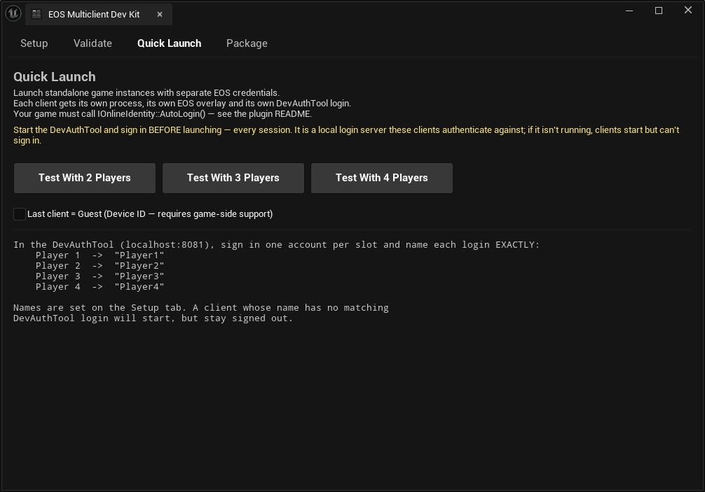
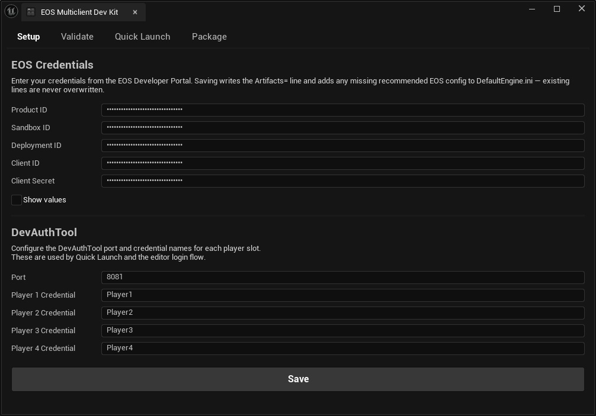
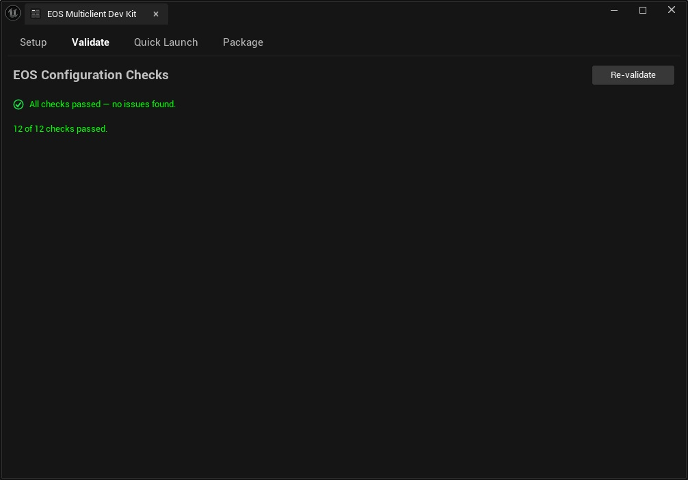
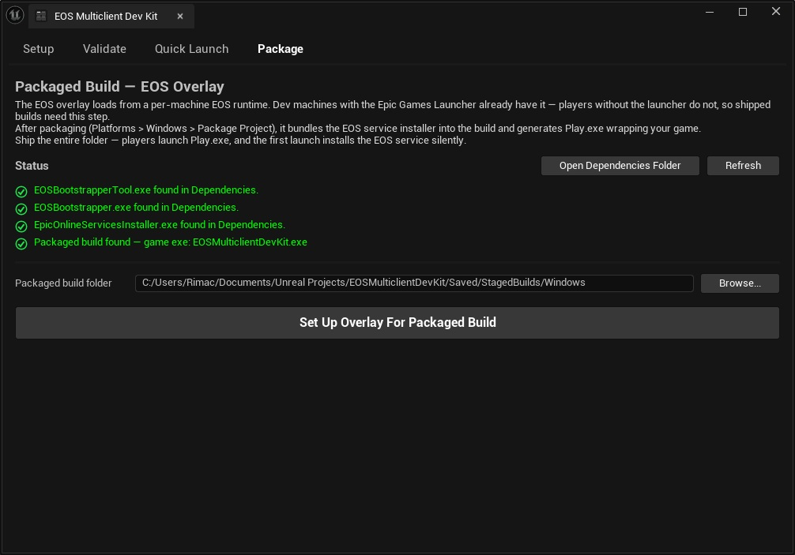

# EOS Multiclient Dev Kit

In-editor multiplayer testing for Epic Online Services: spin up several real, EOS-networked clients
from one machine — each its own process, its own overlay, its own login. The kit also does your
whole EOS setup, validates it with 12 checks, and preps packaged builds for the overlay with one
button.

[](LICENSE)


Unreal Engine 5.7 · Windows · editor-only (nothing ships in your packaged build)
Created by [Ivan "official-rimacc" Rimac](https://github.com/official-rimacc)



---

## Requirements

- **Unreal Engine 5.7** — a C++ project (a Blueprint-only project works too, but it will need to
  become a C++ project to compile the plugin).
- **An EOS product** in the [Epic Games Developer Portal](https://dev.epicgames.com/portal) with a
  client policy that permits P2P.
- **The [EOS DevAuthTool](https://dev.epicgames.com/docs/epic-online-services/accounts-and-social/eos-epic-account-services/developer-authentication-tool)**,
  for logging several accounts in at once. It ships inside the EOS SDK (`SDK/Tools/EOS_DevAuthTool*`) —
  [download the SDK](https://dev.epicgames.com/docs/epic-online-services/eos-get-started/get-started-guide/set-up-account-and-download-eos-sdk)
  from the Developer Portal (it is *not* bundled with Unreal Engine) and drop the extracted tool into
  this plugin's [`Dependencies/`](Dependencies/README.md) folder.
- **Your game must call `IOnlineIdentity::AutoLogin()`** — see [Making Quick Launch work](#making-quick-launch-work).

## Install

Clone (or download) this repo into your project's `Plugins/` folder:

```bash
git clone https://github.com/official-rimacc/EOSMulticlientDevKit.git Plugins/EOSMulticlientDevKit
```

Then regenerate project files and rebuild. The plugin auto-enables `OnlineSubsystemEOS` and
`SocketSubsystemEOS` through its own `.uplugin`, so you do not need to enable those yourself.

Open the panel from **Tools ▸ EOS Multiclient Dev Kit ▸ Open Control Panel**, or the **EOS** button
in the level editor toolbar. The same Tools menu also has shortcuts to validate into the Message
Log, open `DefaultEngine.ini`, open the EOS Developer Portal, and open this README.

---

## Before you start: the EOS Developer Portal

One-time setup in the [Developer Portal](https://dev.epicgames.com/portal), if you haven't done it
already:

- **Create a product.** Everything the Setup tab asks for comes from it.
- **Product ID, Sandbox ID, Deployment ID** — in the product's settings; every product gets a Dev
  sandbox and deployment out of the box.
- **Client ID + Client Secret** — create a client under *Clients* and give it a client policy. The
  stock **Peer2Peer** policy covers this kit's whole flow (sessions, lobbies, P2P) — no custom
  policy actions needed.
- **Epic Account Services application** — required for Epic-account logins, which includes every
  DevAuthTool login. Grant at least *Basic Profile*; add *Friends* and *Online Presence* only if
  your game uses them (the consent screen shows players exactly what you picked).
- Accounts **outside your organization** can only sign in through Epic Account Services after
  Epic's brand review — your own dev accounts work fine before that.

---

## Quick start

**1. Enter your credentials.** Setup tab → Product ID, Sandbox ID, Deployment ID, Client ID, Client
Secret, from the Developer Portal. The fields render as password dots so the tab is always safe to
screenshot or stream — tick **Show values** to double-check a paste. Hit Save. This writes the `Artifacts=` credentials line into
`Config/DefaultEngine.ini` **and fills in every other config line EOS needs** — artifact selection
(`DefaultArtifactName`), auth flags (`bUseEAS`, `bUseEOSConnect`), overlay flags,
`DefaultPlatformService=EOS`, and the EOS net driver. Only missing lines are added; anything you
already configured is left untouched. Quick Launch clients always read the latest saved values (each
is a fresh process); restart the editor only if you also want in-editor EOS features like PIE to
pick them up.



**2. Check the config.** Validate tab → Re-validate. A fresh project should be green after step 1;
anything red or yellow means a pre-existing setting conflicts, and the message says exactly what to
change. All checks are listed [below](#what-the-validator-checks).

**3. Turn OFF "Run Under One Process"** — *Editor Preferences ▸ Level Editor ▸ Play ▸ Multiplayer
Options*. **Strongly recommended** for anyone touching PIE with EOS: the EOS SDK initializes once
per process, so several PIE clients sharing one process share a single EOS identity and misbehave
in confusing ways. Quick Launch is immune either way (its clients are always separate processes),
but with this off, ordinary multi-client PIE behaves over EOS too.

**4. Start the DevAuthTool and sign in.** Run `Dependencies/DevAuthTool/EOS_DevAuthTool.exe` (once
you've dropped it in — see [Dependencies/README.md](Dependencies/README.md)). Sign in one Epic
account per player slot, and **name each login exactly `Player1`, `Player2`, `Player3`, `Player4`** —
these names must match the Setup tab's credential fields character for character, because that's the
name each launched client asks for. The Quick Launch tab always prints the current mapping.

**Leave it running.** The DevAuthTool is a small local login server (`localhost:8081`) that your
clients authenticate against — it is not a one-time setup step. Start it and sign in **every time
you sit down to test**; if it isn't running, clients launch fine but stay signed out.

**5. Launch.** Quick Launch tab → *Test With 2 Players*. You get two tiled standalone windows, each
a separate process with its own EOS login, each writing its own `Saved/Logs/DevKit_<name>.log`.

From here, testing is step 4 + step 5 — start the DevAuthTool, click a button.

---

## Making Quick Launch work

Quick Launch starts each client with the stock Unreal EOS auth switches:

```
-AUTH_TYPE=developer -AUTH_LOGIN=localhost:<port> -AUTH_PASSWORD=<credential name>
```

`FUserManagerEOS::AutoLogin` reads these straight off the command line, so **any project that calls
`AutoLogin` picks up the right account with no extra code.** If your game does its own login flow
and never calls `AutoLogin`, the clients will launch but stay signed out.

The minimum glue, if you don't have it already:

```cpp
if (const IOnlineSubsystem* Subsystem = IOnlineSubsystem::Get())
{
    if (const IOnlineIdentityPtr Identity = Subsystem->GetIdentityInterface())
    {
        Identity->AutoLogin(0);
    }
}
```

Each client is also passed `-EosCredential=<name>` — the raw credential name, for projects that
drive login themselves and want to know which slot they are.

---

## What the validator checks

Twelve checks, run at editor startup (problems surface as a toast) and on demand. They read
`DefaultEngine.ini` as raw text rather
than through `GConfig`, because `GConfig` quietly normalises some of the exact mistakes below.
Commented-out lines are ignored — they can neither trigger a check nor satisfy one.



| # | Check | Severity |
|---|---|---|
| 1 | Credentials present, no `YOUR_...` placeholders, no empty fields | Error |
| 2 | `DefaultArtifactName` matches the `Artifacts` entry's name — mismatch means EOS finds no credentials at startup | Error |
| 3 | Section is `[/Script/OnlineSubsystemEOS.EOSSettings]`, not bare `[EOSSettings]` | Error |
| 4 | No `AuthScopeFlags` — it crashes `EOSShared.dll` at startup | Error |
| 5 | `[OnlineSubsystem] DefaultPlatformService=EOS` is set | Error |
| 6 | `OnlineSubsystemEOS` is enabled | Error |
| 7 | `SocketSubsystemEOS` is enabled | Error |
| 8 | `NetDriverEOS` is configured under `[/Script/Engine.GameEngine]`, with `!NetDriverDefinitions=ClearArray` so it actually wins | Warning |
| 9 | `bUseEAS` and `bUseEOSConnect` are `true` — engine defaults are `false`, which disables login and sessions | Warning |
| 10 | `bEnableOverlay` and `bEnableSocialOverlay` are `true` — engine defaults are `false`, so no per-client overlay | Warning |
| 11 | `bEnableEditorOverlay` is not `true` — it crashes PIE | Warning |
| 12 | `ClientEncryptionKey`, not the pre-5.7 `EncryptionKey` | Warning |

---

## Packaged builds: enabling the EOS overlay

The EOS overlay is loaded from a **per-machine EOS runtime** that Epic installs and updates
centrally — it is never bundled with your game. Machines with the Epic Games Launcher already have
that runtime, which is why the overlay shows up in Quick Launch clients on a dev machine with no
extra steps (PIE never gets it — that's by engine design). Players *without* the launcher have no
runtime, so for them the overlay silently doesn't exist. The **Package tab** closes that gap for
builds you distribute outside the Epic Games Store:



1. Drop `EOSBootstrapperTool.exe`, `EOSBootstrapper.exe`, and `EpicOnlineServicesInstaller.exe`
   (all from the [EOS SDK](https://dev.epicgames.com/docs/epic-online-services/eos-get-started/get-started-guide/set-up-account-and-download-eos-sdk)'s
   `SDK/Tools/`) into [`Dependencies/`](Dependencies/README.md) — one-time.
   The tab's status list shows what's present, and *Open Dependencies Folder* takes you there.
2. Package your game (*Platforms ▸ Windows ▸ Package Project*).
3. Package tab → **Set Up Overlay For Packaged Build**. It bundles the EOS service installer into
   the build and generates **`Play.exe`** wrapping your game exe, with the output shown in the tab.

Ship the entire staged folder. Players launch `Play.exe` — first launch installs the EOS service
silently, and the overlay works from then on. The tab auto-detects your packaged exe under
`Saved/StagedBuilds/Windows`; use the folder box to point anywhere else.

When you don't need this: shipping on the Epic Games Store (the launcher does the bootstrapper's
job there), or not using the overlay at all — auth, sessions, P2P and voice all work without it.

Note: the overlay's *social* features need a real Epic account login (EAS), not just a DevAuthTool
credential.

## Notes and gotchas

**Your Client Secret goes into `Config/DefaultEngine.ini`.** That is where Unreal expects it, and
it is how Epic's own documentation sets EOS up — but it does mean the secret lands in a file most
projects commit. It is a client credential for a dev sandbox rather than a server key, so this is
normal practice; just make a deliberate decision about it before pushing a public repo.

**Credential changes may require an editor restart.** The editor process reads EOS settings once at
startup, so its own EOS features (PIE login, presence in-editor) see changes only after a restart.
Quick Launch clients are separate processes and always read the latest saved values — no restart
needed for them. The Setup tab shows a banner after a change that this applies to.

**Save is add-only.** It fills in missing config lines but never overwrites a value you set
yourself. If one of your existing values conflicts with what EOS needs, the Validate tab reports it
instead of silently changing it.

**The DevAuthTool must be running, signed in, every session.** It's a local login server, not a
one-time setup — the clients authenticate against it at launch. No DevAuthTool, no login. Sign-ins
persist between runs of the tool, so restarting it is usually just launching it again.

**DevAuthTool names must match exactly.** `Player1` is not `player1` and not `Player 1`. A client
whose credential name has no matching DevAuthTool login will launch and stay signed out — this is
the single most common cause of "my clients won't log in". The Quick Launch tab prints the current
mapping; change the names on the Setup tab if you prefer different ones.

**Testing through PIE instead.** With *Run Under One Process* off (quick start step 3),
multi-client PIE works over EOS — each client process runs its own EOS platform. PIE clients don't
get per-client DevAuthTool credentials though; distinct logins per client (real invites, presence
between different accounts) is exactly what Quick Launch is for.

**Guest login is advanced and needs game-side support.** The Quick Launch checkbox passes
`-EosGuestLogin` to the last client, for projects that implement an anonymous EOS Connect Device ID
login. Stock UE 5.7 has no Device ID path — nothing in the engine calls `EOS_Connect_CreateDeviceId` —
so the flag does nothing on its own; implementing it means either extending `OnlineSubsystemEOS`
with a device-id credential type or calling the EOS SDK's Connect API directly. Note also that a
device ID is bound to your Windows user, so two guests on one machine would share a ProductUserId —
hence "last client only".

**Where settings are stored.** Credentials go to `Config/DefaultEngine.ini`. The DevAuthTool port and
credential names are written through `GConfig`, which lands them in
`Saved/Config/WindowsEditor/Engine.ini` — per-user and normally untracked. To share them with your
team, put an `[EOSMulticlientDevKit.DevAuthTool]` section in `Config/DefaultEngine.ini` by hand; it
is read from there.

---

## Privacy: no servers, no telemetry

I personally don't gather, receive, or verify anything
(auditable in [`EOSMulticlientDevKitEditor.Build.cs`](Source/EOSMulticlientDevKitEditor/EOSMulticlientDevKitEditor.Build.cs)).

All network traffic in this workflow is between you and Epic: your game and editor talk to Epic
Online Services through Epic's own plugins, SDK, and tools. What Epic's components transmit is
governed by Epic's privacy policy, not by this plugin. Your credentials are written to
`Config/DefaultEngine.ini`, where the engine reads them to authenticate with Epic; this plugin
sends them nowhere.

**GDPR:** this plugin collects and processes no personal data. Obligations for your game's use of
EOS sit with you and Epic, unchanged by this tool.

---

## License

Source-available — see [LICENSE](LICENSE). Think MIT, minus the right to resell it or pass it off as
your own.

**You can:**
- Build and **sell your games and products** — entirely yours, no royalties, no permission needed.
  (Nothing from the kit ships inside them anyway; it's an editor-only tool.)
- Use it commercially: studios, client work, paid services.
- Modify it, and share free copies with the license and notices intact.

**You can't:**
- Sell the kit itself in any form — original, modified, or rebuilt from it.
- List it on any marketplace or storefront (Fab, itch.io, …), even free.
- Present it, or a modified version, as your own work.

Credit isn't required, but it's always appreciated — there's a line to paste in
[Credits](#credits). For a commercial license to the kit itself: official.ivan.rimac@gmail.com.

## Credits

Created by **Ivan "official-rimacc" Rimac** — [github.com/official-rimacc](https://github.com/official-rimacc).

Using the kit in a project? A credit isn't required, but it's genuinely appreciated:

```
EOS Multiclient Dev Kit by Ivan "official-rimacc" Rimac
```

EOS setup and multiplayer testing normally cost hours. If this kit gave you those hours back, star
the repo — it helps other developers find it.

"EOS" and "Epic Online Services" are trademarks of Epic Games, Inc. This plugin is an independent
tool and is not affiliated with or endorsed by Epic Games.
